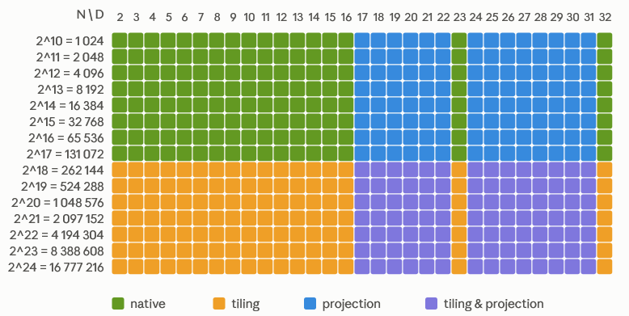
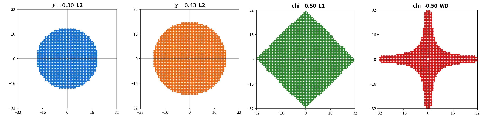

# Hyperuniform Point Clouds Database

This is the GitHub companion repository of the Hyperuniform samples database stored on [`Zenodo`](https://doi.org/10.5281/zenodo.23327095). The database contains hyperuniform point clouds (e.g. blue noise) on the unit hypercube [0,1)ᴰ, sampled with the [`blue-sampler`](https://pypi.org/project/blue-sampler/) Python package.

**2D example** (the N = 1024, D = 2, Chi43 point clouds of this database):


## Installation

```
pip install numpy h5py
```

## Quick Start

First clone this repository:

```
git clone https://github.com/For-a-few-DPPs-more/hyperuniform-samplers.git
cd hyperuniform-samplers
```

Then, from the terminal, load the full database and generate a new randomized point cloud:

```
python src/load_data.py --dim all --chi all
python src/new_data.py --dim 2 --npoints 1024 --chi 30 --seed 42
```

Or from a notebook: open `quick_start.ipynb` and follow the instructions.

## Data characteristics

- **Format:** HDF5 (Python, C++, MATLAB, Julia, R, ...), hosted on Zenodo.
- **Size:** ≈ 712 MB by default, ≈ 3.2 GB with the large point clouds (see note below).
- **Number of points:** native N = 2¹⁰ to 2¹⁷ (powers of 2); up to N = 2²⁴ with tiling.
- **Dimension:** native D = 2 to 16, plus D = 23 and D = 32; any 2 ≤ D ≤ 32 with projection.

[](./src/coverage_table_ND.png)

> **Note: Large storage.** In low dimensions (D ≤ 4), the Zenodo database provides additional, much larger point clouds, to be downloaded manually ([`larges.zip`](https://zenodo.org/records/23327095?preview_file=larges.zip), 2.7 GB). They go up to N = 2²⁷ ≈ 134 million points in 2D, 2²⁵ ≈ 34 million in 3D and 2²¹ ≈ 2 million in 4D.

## Sampling method

The samples were generated by **spectral optimisation** (non-uniform Fourier transform): select a spectral exclusion region, initialise with a random point cloud, then run a gradient descent on the Fourier loss. Each point cloud comes in four versions:

- χ = 0.30: stealthy structure factor S(k) ≤ 10⁻¹⁰ in a standard Euclidean ball;
- χ = 0.43: S(k) ≤ 10⁻⁴ in a 1.5x bigger ball;
- χ = L1-0.50: S(k) ≤ 10⁻² inside an L1 ball (`‖k‖₁ = Σ|kᵢ|`);
- χ = WD-0.50: minimises the wrap-around (WD) discrepancy as a Fourier series, with no stealthiness constraint.

Exclusion regions for the four versions, with N = 1024, D = 2:

[](./src/exclusion_balls.png)

All details for reproducibility are in [SAMPLING.md](SAMPLING.md).

## Guarantees

### Stealthiness

For a wave vector k = (k₁, ..., k_D) with integer components,

```
S(k) = |Σⱼ exp(2iπ ⟨k, xⱼ⟩)|² / N
```

A near-zero S(k) means that the Monte Carlo integration error is controlled for the low-frequency test function x ↦ exp(2iπ ⟨k, x⟩).

S(k) for D = 2 to 16 at N = 1024, with ‖k‖ normalised by 1/δ, δ = `N^(-1/D)`, to compare dimensions:

<details>
<summary>Show the curves (χ = 0.30, 0.43, L1-0.50)</summary>


</details>

### Randomisability

Spectral optimisation enforces periodic boundary conditions, so a sample can be randomised by a simple shift:

```
X_new = (X - s) mod 1, s drawn uniformly in [0,1]^D
```

### Extensibility

`load_data` downloads the samples with 2¹⁰ ≤ N ≤ 2¹⁷ and D = 2 to 16, 23, 32. Other shapes are produced on the fly by `new_data`, at a controlled loss of quality:

- **Tiling** (more points): copies of the periodic point cloud are combined into a larger one, up to N = 2²⁴. The stealthiness degrades proportionally to the increase in points:

  ```
  sup S_t(k) = sup S(k) × N_t / N
  ```

  where N is the original number of points and N_t the number after tiling. See [TILING.md](TILING.md).

  

- **Projection** (lower dimension): 17 ≤ D_proj ≤ 22 is projected from D = 23, and 24 ≤ D_proj ≤ 31 from D = 32. See [PROJECTION.md](PROJECTION.md).

## Use cases

- **Rendering and blue noise:** anti-aliasing, path tracing, dithering, denoising textures.
- **Spatial sampling:** isotropic particle initialisation (SPH, molecular dynamics) with periodic boundary conditions.
- **Monte Carlo / QMC integration:** periodic or smooth integrands (`L1-50` for axial anisotropy, `WD-50` for less regular ones). Random shifts give independent replicas and error bars.
- **Machine learning and design of experiments:** initial designs, surrogate training sets, uncertainty quantification.
- **Hyperuniformity research:** reference data to study structure factors and crystallisation, and to benchmark new samplers.

> **Note:** `L1-50` and `WD-50` are not drop-in replacements for Sobol or Halton sequences: they show slightly weaker discrepancy according to `scipy.stats.qmc.discrepancy`. They are complementary strategies, worth exploring when the integrand has favourable low-frequency spectral properties.

## Acknowledgements

GPU kernel reductions rely on [PyKeOps](https://www.kernel-operations.io):
> Charlier, Feydy, Glaunès, Collin, Durif, "Kernel Operations on the GPU, with Autodiff, without Memory Overflows", *JMLR* 22(74), 2021.

The large 2D and 3D point clouds rely on [FINUFFT](https://github.com/flatironinstitute/finufft):
> Barnett, Magland, af Klinteberg, "A parallel non-uniform fast Fourier transform library based on an exponential of semicircle kernel", *SIAM J. Sci. Comput.* 41(5), 2019.

## Citation

If you use this database, please cite it (see also [`CITATION.cff`](CITATION.cff)):

```bibtex
@dataset{bardenet_lachiezerey_decacqueray_2026_hyperuniform,
  author    = {Bardenet, Rémi and Lachièze-Rey, Raphaël and de Cacqueray, Armand},
  title     = {Hyperuniform samples (stealthy point clouds)},
  year      = {2026},
  publisher = {Zenodo},
  version   = {v3},
  doi       = {10.5281/zenodo.23327095},
  url       = {https://doi.org/10.5281/zenodo.23327095}
}
```

## Licence

The database and the source code are free to use under the **MIT licence**.
