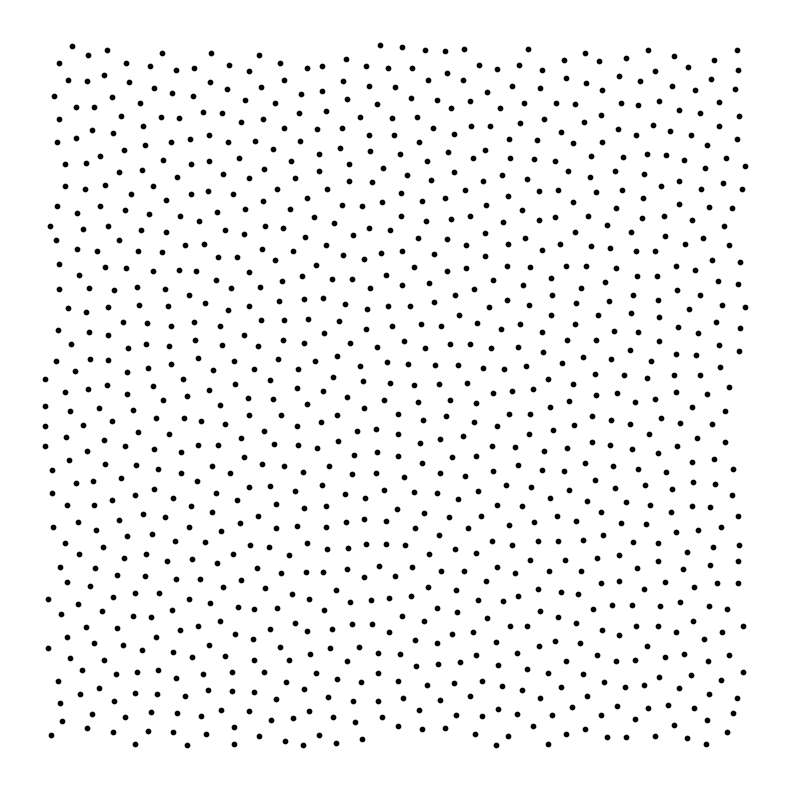
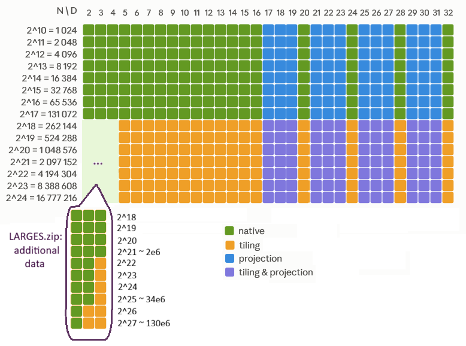
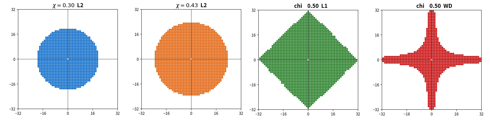
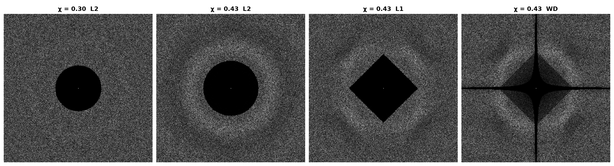
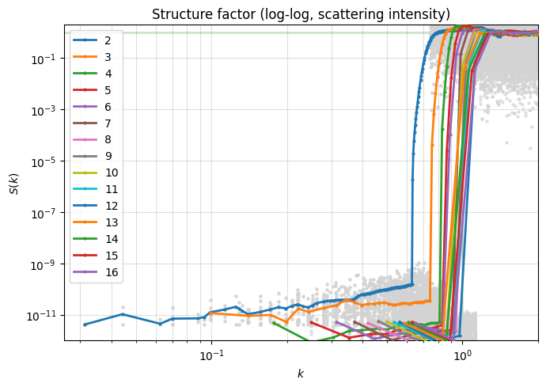
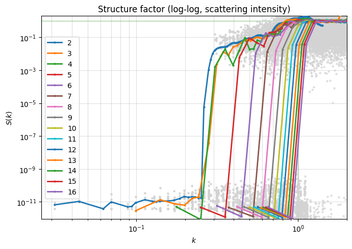
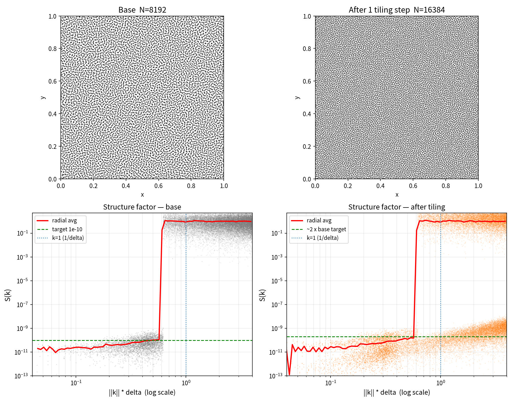

# Hyperuniform Point Clouds Database

[](https://doi.org/10.5281/zenodo.23605844)
[](https://github.com/For-a-few-DPPs-more/hyperuniform-samplers)
[](https://for-a-few-dpps-more.github.io/hyperuniform-samplers/)


This repository distributes the Hyperuniform samples database, published  on [Zenodo](https://doi.org/10.5281/zenodo.23605844). The database contains hyperuniform point clouds (e.g. blue noise) on the unit hypercube [0,1)ᴰ.

**2D example** (the N = 1024, D = 2 point clouds (l2) of this database) :



## Installation

```
pip install numpy h5py
```

Optional: `scipy` for the benchmark, `matplotlib` and `blue-sampler` for the analysis cells of the notebook. 

## Quick Start

First clone this repository:

```
git clone https://github.com/For-a-few-DPPs-more/hyperuniform-samplers.git
cd hyperuniform-samplers
```

Then, from the terminal, load the full database and generate a new randomized point cloud:

```
python src/load_data.py --dim all --ball all
python src/new_data.py --dim 2 --npoints 1024 --ball l2 --seed 42
```

Or from a notebook: see [quick_start.ipynb](https://for-a-few-dpps-more.github.io/hyperuniform-samplers/infos/quick_start.html) and follow the instructions.

## Data characteristics

- **Format:** HDF5 (Python, C++, MATLAB, Julia, R, ...).
- **Size:** ≈ 500 MB by default, ≈ 3.2 GB with the large point clouds (see note below).
- **Number of points:** native N = 2¹⁰ to 2¹⁷ (powers of 2); up to N = 2²⁴ with tiling.
- **Dimension:** native D = 2 to 16, plus D = 20, 24, 28 and D = 32; any 2 ≤ D ≤ 32 with projection.

> **Note: Large storage.** In low dimensions (D ≤ 4), the Zenodo database provides additional, much larger point clouds, to be downloaded manually ([`larges.zip`](https://zenodo.org/records/23605844?preview_file=larges.zip), 2.7 GB). They go up to N = 2²⁷ ≈ 134 million points in 2D, 2²⁵ ≈ 34 million in 3D and 2²¹ ≈ 2 million in 4D.

[](./plots/coverage_table_ND.png)

## Sampling method
The samples were generated by **spectral optimisation** (non-uniform Fourier transform) with the [`qmc-sampler`](./qmc_sampler/README.md) Python package: the sampling algorithm selects a spectral exclusion set of wave vectors, initialises the point cloud with i.i.d. uniform points in the unit hypercube, runs a gradient descent on the Fourier loss, and completes the optimisation with a quasi-Newton (L-BFGS) finishing. For speed, the whole optimisation runs in float32 and reaches an almost minimal configuration, S(k) ≤ 2·10⁻¹⁴ N + 3·10⁻¹² |k|² for all excluded wave vectors[^1], which is the level at which the L-BFGS optimiser empirically starts stalling due to numerical precision. Each resulting point cloud comes in two versions:

[^1]: An exhaustive float64 check of the whole dataset shows that a marginal proportion of the wave vectors (0.0002 %), all in the `wd` case, exceed this bound, by up to a factor 20 while remaining below S(k) ≤ 10⁻³. The phenomenon is not fully understood, most likely a numerical artifact at specific axial frequencies. These wave vectors are listed in [infos/STEALTHY.md](https://github.com/For-a-few-DPPs-more/hyperuniform-samplers/blob/main/infos/STEALTHY.md).

- l2: stealthy scattering intensity in a standard Euclidean ball (thus, an "l2" ball) of wave vectors |k| ≤ cst ;
- wd: stealthy scattering intensity in an exclusion set defined as r(k) >= cst, where r(k) is the fourier decomposition of the wrap-around discrepancy (thus, "wd" which stand for wrap-around discrepancy);

Note that l2 is isotropic (rotation invariant), which is good for blue noise properties, and wd has a stary, axis oriented shape which is good for qmc integration on low effective dimensional integrands:

[](./plots/exclusion_balls.png)

All details for reproducibility are in [SAMPLING.md](infos/SAMPLING.md).

## Guarantees

### Stealthiness

For a wave vector k = (k₁, ..., k_D) with integer components, let define the scattering intensity S(k) as:

```
S(k) = |Σⱼ exp(2iπ ⟨k, xⱼ⟩)|² / N
```

A near-zero S(k), as here for the provided samples (S(k) ≤ 2·10⁻¹⁴ N + 3·10⁻¹² |k|²) means that the Monte Carlo integration error is controlled for the low-frequency test function x ↦ exp(2iπ ⟨k, x⟩). The number of such controlled wave vectors is at most 2 * Chi * (N -1) * D where Chi is an hyperparametter that we set to 0.43 (common choices are 0.3 and 0.4, see for exemple [Morse et al. (2023)](https://doi.org/10.1103/PhysRevResearch.5.033190) ) and the factor 2 comes from the symmetry S(k) = S(-k). 

Following plots show the values of S(k) for the 2 ball families, 1. as a power spectrum map (kx, ky) ↦ S(k) for 2d point clouds only and 2. as a radial |k| ↦ S(k) curve (average over radial bins) for all dimensions D = 2 to 16 : 

- (kx, ky) ↦ S(k) power spectrums for 2D point clouds
      
l2 and wd ball, N = 8192, D = 2
      


      
- |k| ↦ S(k) curves, |k| normalised by N^1/D for better readability 

l2 ball, N = 1024, D = 2 to 16



wd ball, N = 1024, D = 2 to 16



### Randomisability

Spectral optimisation enforces periodic boundary conditions, so a sample can be randomised by a simple shift:

```
X_new = (X - s) mod 1, s drawn uniformly in [0,1]^D
```

### Extensibility

`src/load_data.py` downloads the samples with 2¹⁰ ≤ N ≤ 2¹⁷ and D = 2 to 16, 20, 24, 28, 32. Other (N, D) shapes are produced on the fly by `src/new_data.py`, at a controlled loss of quality:

- **Tiling** (more points): copies of the periodic point cloud are combined into a larger one, up to N = 2²⁴. The stealthiness degrades at most proportionally to the increase in points:

  ```
  sup S_t(k) ≤ sup S(k) × N_t / N
  ```

  where N is the original number of points and N_t the number after tiling. See [TILING.md](infos/TILING.md).

  

  ⚠️ Warning : The tiling procedure implemented here relies on 45° rotations of the points, except for certain special powers-of-two number of points. Tiling should therefore be used with caution for non-isotropic (WD) hyperuniform samples, as it will break axial alignment.

- **Projection** (lower dimension): 17 ≤ D_proj ≤ 19 is projected from D = 20, 21 ≤ D_proj ≤ 23 from D = 24 and so on. ⚠️ Projection also comes with additional caveats, see [PROJECTION.md](infos/PROJECTION.md).

## Use cases

- **Rendering and blue noise:** anti-aliasing, path tracing, dithering, denoising textures.
- **Spatial sampling:** isotropic particle initialisation (SPH, molecular dynamics) with periodic boundary conditions.
- **Monte Carlo / QMC integration:** especially for periodic or smooth integrands, see [BENCHMARK.md](infos/BENCHMARK.md) for discrepancy comparison with Sobol and Halton sequences. Random shifts give independent replicas for error bars
- **Machine learning and design of experiments:** initial designs, uncertainty quantification.
- **Hyperuniformity research:** reference data to study structure factors and to benchmark new samplers.


> **Note - adaptative sampling** Although this database contains only uniform samples, spectral optimisation can be adapted to non-uniform target distributions (not covered by this repository). This could be of use for importance sampling or when one require well distributed points, but under a specific spatial distribution. 

## Acknowledgements

GPU kernel reductions rely on [PyKeOps](https://www.kernel-operations.io):
> Charlier, Feydy, Glaunès, Collin, Durif, "Kernel Operations on the GPU, with Autodiff, without Memory Overflows", *JMLR* 22(74), 2021.

The large 2D and 3D point clouds rely on [FINUFFT](https://github.com/flatironinstitute/finufft):
> Barnett, Magland, af Klinteberg, "A parallel non-uniform fast Fourier transform library based on an exponential of semicircle kernel", *SIAM J. Sci. Comput.* 41(5), 2019.

## Citation

If you use this database, you can cite it as:

```bibtex
@dataset{bardenet_lachiezerey_decacqueray_2026_hyperuniform,
  author    = {Bardenet, Rémi and Lachièze-Rey, Raphaël and de Cacqueray, Armand},
  title     = {Hyperuniform samples (stealthy point clouds)},
  year      = {2026},
  publisher = {Zenodo},
  version   = {v5},
  doi       = {10.5281/zenodo.23605844},
  url       = {https://doi.org/10.5281/zenodo.23605844}
}
```

## Licence

The database and the source code are free to use under the **MIT licence**.
