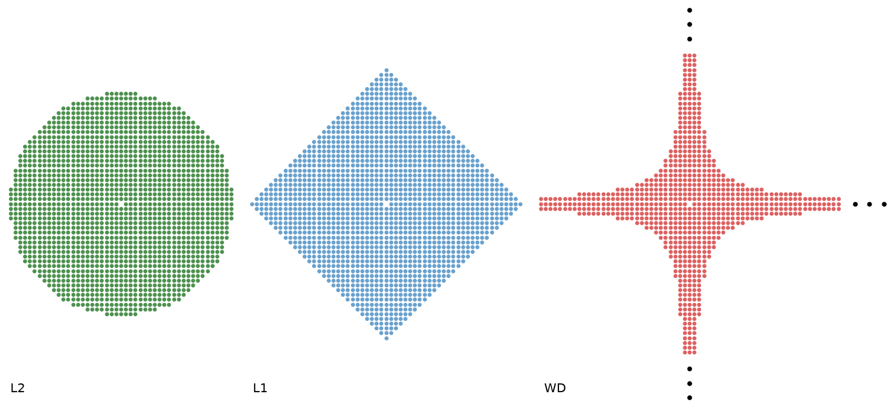

# qmc-sampler

[](https://pypi.org/project/qmc-sampler/)
[](https://github.com/For-a-few-DPPs-more/hyperuniform-samplers)
[](https://doi.org/10.5281/zenodo.23605844)

**Quasi-Monte Carlo point sets by spectral optimisation.**

`qmc-sampler` generates QMC point sets on the torus [0, 1)^D by minimising the Fourier
coefficients of the points over every wave vector of an exclusion region. It was used to
generate a large dataset of hyperuniform point sets, published on
[Zenodo](https://doi.org/10.5281/zenodo.23605844).

## Installation

```bash
pip install qmc-sampler
```

## Usage

```python
from qmc_sampler import sample_l2, sample_l1, sample_wd

x = sample_l2(1000, 2)            # (N, D) array of points in [0, 1)^D
```

Three shapes of exclusion region are available:

- **`sample_l2(N, D)`**: isotropic L2 ball, the classical choice.
- **`sample_l1(N, D)`**: L1 ball, anisotropic, useful when the integrand has a low effective dimension.
- **`sample_wd(N, D)`**: weights of the wrap-around discrepancy, which push this low-effective-dimension idea further.



Extra parameters (`Chi`, `n_iter`, `seed`, ...) can be set to the samplers. They are described,
together with the module settings (backend, precision, NUFFT tolerance), in
[Params.md](https://github.com/For-a-few-DPPs-more/hyperuniform-samplers/blob/main/qmc_sampler/Params.md).

## Precision: float32 by default

Computations run in **float32** by default. This is a deliberate choice: it roughly halves memory
use and is much faster on GPU (KeOps, torch, cuFINUFFT), which matters for large `N` and `D`. The
price is a floor on the reachable structure factor, which grows with `N` and `|k|`:

  S(**k**) ≤ α N + β |**k**|²,  with α = 2·10⁻¹⁴ and β = 3·10⁻¹²

For a deeper optimisation, switch to float64. Like the backend, the precision is a module
setting: it applies to the samplers **and** to the structure factor, so that points are always
measured with the precision they were sampled with.

```python
import qmc_sampler

qmc_sampler.select_precision("float64")
x = qmc_sampler.sample_l2(1000, 2)
qmc_sampler.plot_structure_factor(x)      # also in float64
```

## Backends

We provide four different backends for computing the Fourier kernel. All four are available,
provided that their respective dependencies are properly installed on the user's system. 
Backend selection affects both computational speed and numerical precision, and should therefore 
be made with extra care for big scale or high precision experiments.


| backend       | method                                  | cost           | dimensions | accuracy                                    |
|---------------|-----------------------------------------|----------------|------------|---------------------------------------------|
| `"keops"`     | direct sums, pykeops (GPU if available) | O(N M)         | any        | exact (machine precision)                   |
| `"torch"`     | direct sums, torch (CUDA if available)  | O(N M)         | any        | exact (machine precision)                   |
| `"cufinufft"` | non-uniform FFT on GPU (cufinufft + cupy) | O(N log N + M) | D <= 3   | `nufft_tolerance` (auto: 1e-4 float32, 1e-8 float64) |
| `"finufft"`   | non-uniform FFT on CPU                  | O(N log N + M) | D <= 3     | `nufft_tolerance` (auto: 1e-4 float32, 1e-8 float64) |

`M` is the number of wave vectors and grows like `N`. Unless told otherwise, `qmc-sampler` uses
the first available backend in the order of the table, so by default every sum is exact.

**In 2D and 3D, (cu)FINUFFT is strongly recommended**, for l2 and l1 sampling: one iteration costs 
O(N log N) instead of O(N^2), which is usually one or more orders of magnitude faster and makes large `N` reachable.
The default (cu)FINUFFT tolerance (`"auto"`, which depends on the precision) trades accuracy for
speed; lower it, in float64, to go down to machine precision.

```bash
pip install finufft                  # or: pip install "qmc-sampler[finufft]"
pip install cufinufft cupy-cuda12x   # GPU, CUDA 12 (CUDA 11: cupy-cuda11x)
```

```python
import qmc_sampler

qmc_sampler.select_backend(dimensions={2, 3}, backend="finufft")   # or "cufinufft"
qmc_sampler.select_nufft_tolerance(1e-12)                          # default "auto"
```

## Plotting

```python
from qmc_sampler import plot, plot_structure_factor   # adapted from blue_sampler
```

`plot_structure_factor` uses the same module settings as the samplers (backend of the
dimension of the points, precision, NUFFT tolerance).

## Links

- **Source:** [GitHub repository](https://github.com/For-a-few-DPPs-more/hyperuniform-samplers)
- **Package:** [PyPI](https://pypi.org/project/qmc-sampler/)
- **Dataset:** [Zenodo](https://doi.org/10.5281/zenodo.23605844)

## License

MIT
